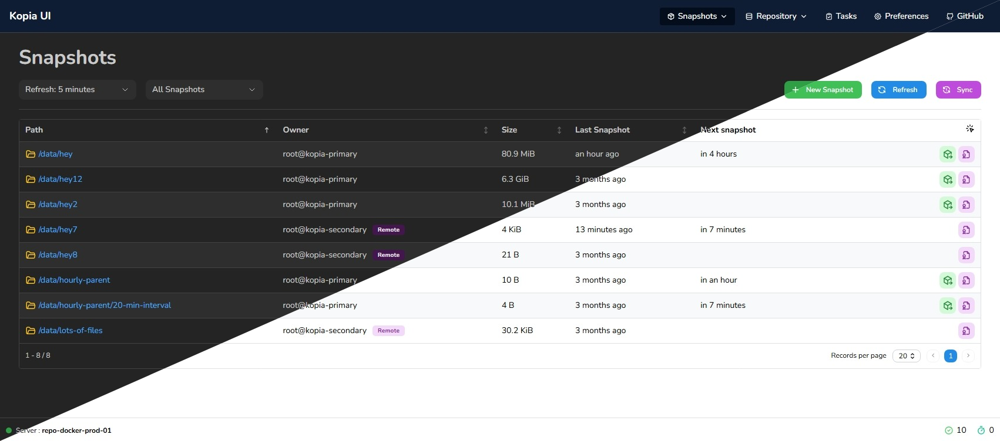
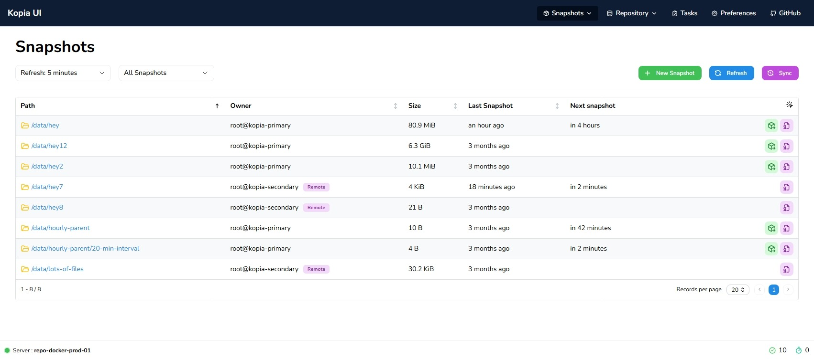
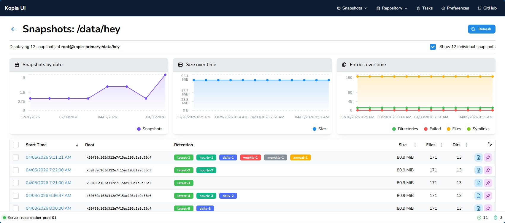
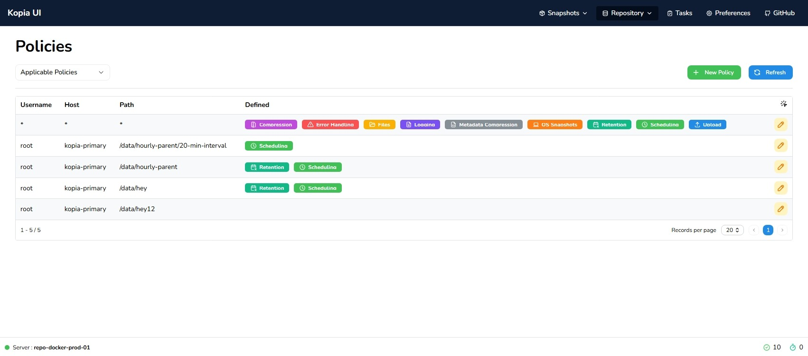
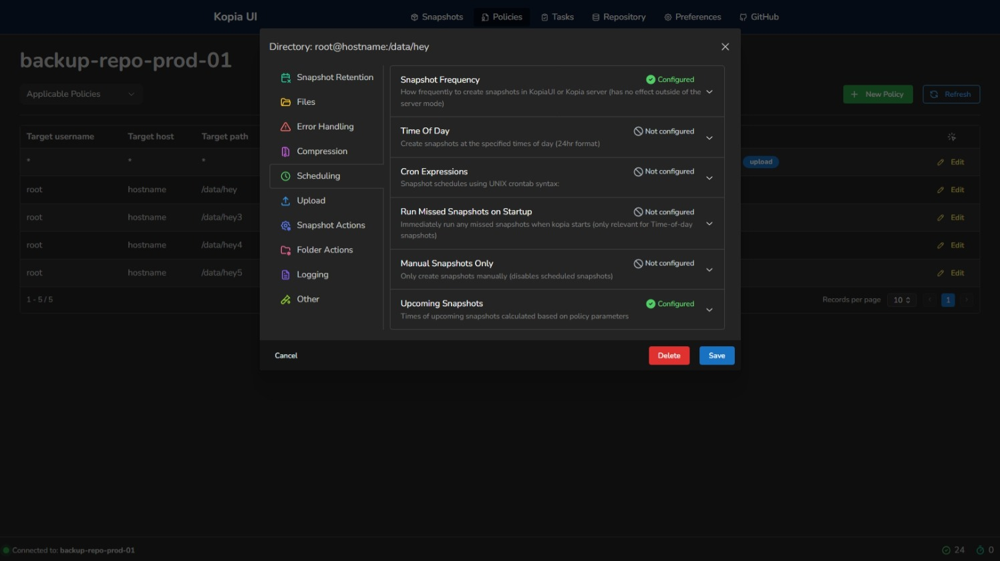
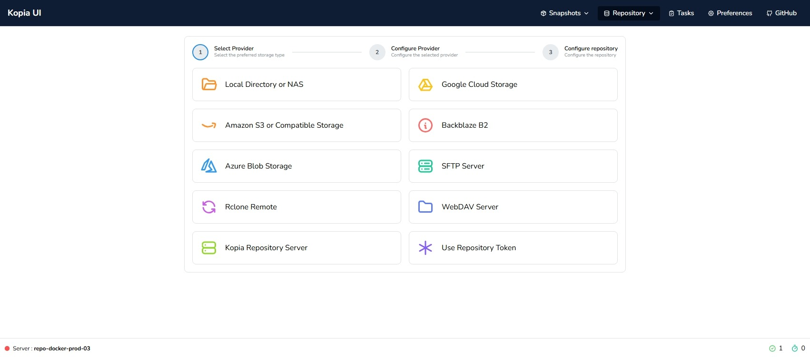
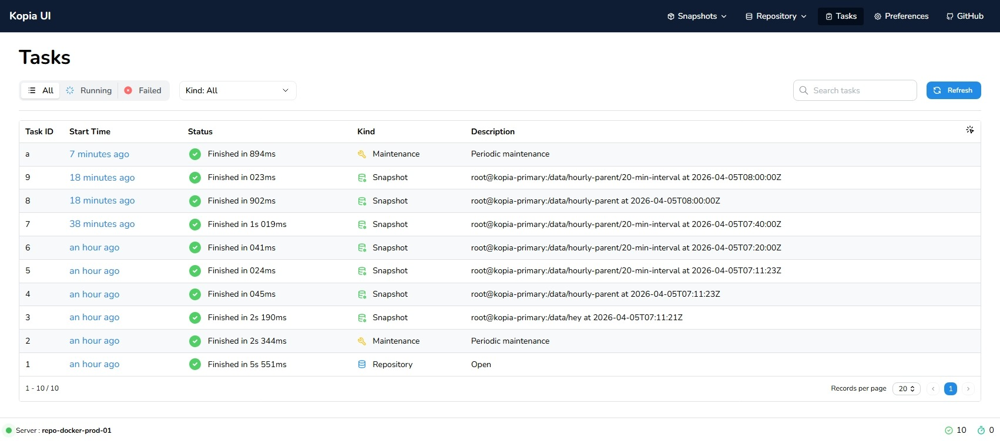

<a id="readme-top"></a>

<div align="center">
  <!-- <a href="https://github.com/joachimdalen/kopia-alternate-ui">
    
  </a> -->

  <h1 align="center">Kopia electron 中文界面</h1>

  <p align="center">
    This project provides a dropin replacement for the original KopiaUI!
  </p>
</div>

## 在 Kopia 服务中使用（单服务器）

构建适用于 Kopia Web 服务器的静态 UI：

```powershell
npm ci
npm run build:kopia
kopia server start --html=dist
```

访问 Kopia 服务地址即可。`--html` 让 Kopia 同源托管 `dist` 页面和静态资源；此构建直接调用 Kopia `/api/v1` 接口，并使用页面注入的 CSRF token，不需要额外的 Nginx 代理或 `instances.json`。此模式连接当前 Kopia 服务；普通 `npm run build` 仍保留原来的多服务器部署方式。

### 编译进 Kopia 二进制

本目录也是兼容 `github.com/kopia/htmluibuild` 的 Go 静态资源模块。先运行
`npm run build:kopia` 生成 `dist`，再在 Kopia 构建工作区中将
`github.com/kopia/htmluibuild` 替换为本目录。不要使用 `nohtmlui` 构建标签。

Go 服务、Electron 外壳和自定义 React UI 已合并在同一 Git 仓库中。
UI 源码位于 `htmlui`，不再要求相邻的 UI 仓库，也不再跟随 UI 上游。
首次构建在 `htmlui` 和 `app` 中分别执行 `npm ci`，再从仓库根目录执行：

```powershell
& .\tools\build-local-ui.ps1
# 仅构建页面和 Go 服务，不打包 Electron：
& .\tools\build-local-ui.ps1 -SkipElectron
```

该二进制无需 `--html` 即使用新界面，Electron 外壳继续使用原来的 Kopia
服务器启动、认证及更新流程。默认语言为简体中文，偏好设置中可切换英文或挪威语；
用户文件名、路径、算法标识和服务器原始日志不翻译。
内嵌模式沿用 Kopia 认证，不在浏览器中保存服务器密码，且无需关闭 CSRF 校验。
本仓库保留 Apache-2.0 许可，分发时需保留许可文件。

### Electron 文件选择

内嵌构建在 KopiaUI 桌面窗口中使用 Electron 原生文件对话框：快照来源、
本地仓库和策略目录选择目录；恢复到目录时选择目录，恢复到 ZIP/TAR 时使用保存对话框；
Google Cloud 凭据、SFTP 密钥/known_hosts、SSH 和 Rclone 程序路径选择文件。
快照文件下载也使用原生保存对话框。取消选择不会清空原路径，选择失败会显示错误。
桌面版本机路径框点击后直接打开原生对话框，也可使用旁边的选择按钮，不需要手填路径。
保留键盘编辑能力，以便清空可选凭据或程序路径、恢复默认配置。
快照来源选定后会自动解析路径，仍需确认才能开始备份或恢复。

浏览器访问或普通多服务器构建不显示本机文件选择按钮，仍可输入 Kopia 服务所在机器的路径。
SFTP、WebDAV、Rclone 的远程存储路径不是本地文件路径，不使用本机文件对话框。
策略中的操作脚本是脚本内容，继续使用代码编辑器，而不是选择脚本文件。

### 更新并关机

KopiaUI 桌面版的已连接仓库页在“断开连接”前提供“更新并关机”。
原生确认后，通过当前仓库服务调用与普通快照更新相同的接口，依次更新属于本机用户和主机的所有备份源，
包括手动备份源，不额外启用 CLI 的 `--fail-fast`。更新期间请保持 KopiaUI 运行；
可在快照和任务页面查看进度及日志。等待对应的新任务成功完成和快照状态刷新后才考虑关机。
任务成功结束即可关机，即使有文件读取错误、错误计数缺失或快照不完整；
部分文件可能未备份，请在任务页面查看错误日志。
任务失败、取消、无法确认完成或服务端仍有备份任务时不会关机。已暂停的备份源需先恢复。
相同内容可按保留策略跳过新快照。成功后调用 Windows、macOS 或 Linux 关机命令，
预留 60 秒，不强制关闭其他应用；系统必须授予关机权限。
浏览器和多服务器部署不提供此按钮。需同步重建 UI、Kopia 二进制和 Electron 包。

### 恢复偏好设置与覆盖确认

“偏好设置 → 恢复”统一保存恢复格式、增量恢复、错误处理、浅恢复、权限、
覆盖和 ZIP 压缩等默认选项，重启后继续使用。恢复窗口仅需选择格式和目标位置。
不论是否启用覆盖选项，目标已有非空文件夹或文件（含 ZIP/TAR）时都会先提示
“全部替换 / 取消”，确认前不会启动任务或写入文件。“全部替换”合并文件夹、
覆盖同名文件并保留其他文件，本次恢复不跳过已恢复文件；“取消”终止整次恢复。
此功能需要同步重新编译 Kopia 后端。

### 快照日志与任务进度

快照列表的“快照日志”可查看最近的快照任务；上传中的日志按钮可直接打开任务详情，
显示进度、计数和日志，并可停止任务。上传进度悬浮详情显示文件数、目录和最近的错误。
日志默认保留最近 100 条普通日志和所有错误日志，支持搜索，错误的多行内容和结构化
参数完整显示，不省略长路径或错误详情。运行和取消中的任务自动刷新，结束后再获取最终日志。
估算快照也使用相同的日志展示。此限制按任务计算；服务仍只保留最近的已完成任务，
重启服务后内存任务记录不保留。

需要同时重新编译 Kopia 后端，避免旧版后端在 UI 收到日志前淘汰错误记录。
快照“所有/本地”默认视图沿用偏好设置，在快照列表切换后会保存。

### 老界面功能补齐

快照历史和目录页面显示未完成原因、失败路径及完整错误详情；若服务端只返回部分失败
条目，会提示剩余详情不可用。桌面版挂载快照后可直接“浏览挂载目录”，浏览器版不显示
本机浏览按钮。快照列表、历史、目录、策略及仓库信息页可展开等效命令行并复制，
支持 PowerShell 和 POSIX Shell 的路径转义；命令不包含仓库密码等凭据。
命令应在 Kopia 服务器上、使用对应仓库配置执行。

> [!IMPORTANT]
> Kopia Alternate UI is not affiliated with or endorsed by the Kopia developers.

<!-- ABOUT THE PROJECT -->

## About The Project



> [!CAUTION]
> This project is under active development, even though it might be a while between commits. It should be mostly operational, but usage will determine potential bugs. Please see the [feature mapping](https://github.com/joachimdalen/kopia-alternate-ui/issues/5) issue for progress on implementing existing features.

I wanted a cleaner and easier to use UI for Kopia than the offical one. There are also some features I want to implement that is not in the official UI, such as multi server interaction, improved statistics and more.

>If this project helped you or you are interested in using it, please consider giving it a ⭐️! It's the only way I will be able to see the usage of this tool and how much time should be spent improving/finishing it.

## Features

- 🎨 Clean UI
- 🇳🇴 Localized (Currently supports English and Norwegain)
- 🖥️ Multi repository server support


|                                       |                                  |
| ------------------------------------- | -------------------------------- |
|      |  |
|      |  |
|  |     |


## Getting Started

### Configure

The support for multiple servers must currently be configured manually. We have an issue []() to have this happen automatically when the container start, and that feature will be implemented later on.

1. Create a new json file. For examples we will use `instances.json`. This file will contains all the instances you should be able to switch between.

```json
[
  {
    "id": "primary",
    "name": "docker-primary-01",
    "default": true
  },
  {
    "id": "secondary",
    "name": "docker-secondary-01",
    "default": false
  }
]
```

- `id`: Should be unique across all instances. This is the key we will route the Nginx proxy based on.
- `name`: The display name used in the dropdown in the UI
- `default`: When `true`, will be the default selected instances in the UI

2. Use the [example `nginx.conf`](./docker/nginx.conf) as a reference and add new location blocks for your instances (You can remove the example `primary` and `secondary` blocks). During this step you will also need to decide how you want to authenticate aginst the servers. Please see [Authenticating to servers](#authenticating-to-servers) for more information.

```nginx
location /api/[INSTANCE-ID] {
  rewrite ^/api/[INSTANCE-ID]/(.*) /api/$1 break;
  proxy_pass https://[DOCKER-CONTAINER]:51515;

  # --- AUTH OPTION TWO ---
  proxy_hide_header WWW-Authenticate;
  # --- AUTH OPTION TWO END ---

  # --- AUTH OPTION THREE ---
  proxy_hide_header WWW-Authenticate;
  proxy_set_header Authorization "Basic ${INSTANCE_AUTH}";
  proxy_pass_header Authorization;
  # --- AUTH OPTION THREE END ---

  expires -1;
}
```

> [!IMPORTANT]
> Currently the container is using a Nginx templating feature. This means you will have to re-create or restart the container for changes to apply.

3. Mount the `instances.json` file and your custom `nginx.conf` file to the container

> See the releases page for the latest version

```yml
services:
  kopiaaltui:
    conatiner_name: kopia-ui
    image: ghcr.io/joachimdalen/kopia-alternate-ui:v0.4
    ports:
      - 8080:80
    volumes:
      - ../docker/instances.json:/app/config/instances.json:ro
      - ../docker/nginx.conf:/etc/nginx/templates/default.conf.template:ro
    environment:
      # Enables you to pass more predefined intervals for snapshots
      # By default the following is set: 600, 900, 1200, 1800, 3600, 10800, 21600, 43200
      # Pass values in seconds
      VITE_PUBLIC_SNAPSHOT_INTERVALS="86400,172800,604800"
```

### Authenticating to servers

Authentication is supported using three different methods

#### Option 1: Passthrough

Passthrough authentication uses the regular authentication popup that comes with KopiaUI. This can lead to you having to authenticate multiple times and often.

#### Option 2: Integrated authentication

This application offers a simple credential management feature that you can use at your own risk. When a server responds with a `401` status code - a login window will appear.

> [!CAUTION]
> These credentials are stored in the browser session under the key `kopia-alt-ui-auth` in clear text. When switching between instances we lookup credentials in this storage and apply it to the request.

**NOTE:** Remember to remove the `WWW-Authenticate` in your Nginx configuration for this feature to work properly.

#### Option 3: Nginx authentication

The third option is to allow Nginx to handle the authentication. This means that all requests will be authenticated by default and anyone with access to UI will have the same access as the user.

To add this option:

1. `base64` encode your username and password

   ```sh
   echo -n "USERNAME:PASSWORD" | base64 # Outputs: VVNFUk5BTUU6UEFTU1dPUkQ=
   ```

2. Pass the encoded value to your container
3. Use the username and password in your `nginx.conf` file like shown in the example configuration above

## Development

The development setup requires a few instances of Kopia to run. These can be configured using the [docker-compose.yml](./.dev/docker-compose.yml) file.

1. Uncomment the `--tls-generate-cert` argument
2. Run `docker compose up`
3. Copy the value of `SERVER CERT SHA256` that is outputted from `kopia-primary`, you will need this later
4. Comment out the `--tls-generate-cert` argument again as Kopia will fail to start later if this is defined
5. Execute the command `kopia server user add root@kopia-secondary` in the `kopia-primary` container. Make a note of the password you set for this user.
6. Start the application using `npm dev`
7. Login using `USER_ONE` and `PASSWORD_ONE` when prompted for credentials for `repo-docker-prod-01 / primary`
8. Add a new `filesystem` repo targeting `/repository` and use the password `PASSWORD_ONE`
9. Switch to the `repo-docker-prod-02 / slave` instance and login using the credentials `USER_TWO` and `PASSWORD_TWO`
10. Add a new `Kopia Repository Server` repository.
    - Use the url `https://kopia-primary:51515` and the `SERVER CERT SHA256` value from step 3.
    - Use the password for the user created in step 5

You can now start using the application and configure backups as needed.

## License

Distributed under the Apache License 2.0 License. See `LICENSE` for more information.

<p align="right">(<a href="#readme-top">back to top</a>)</p>

<!--  -->
